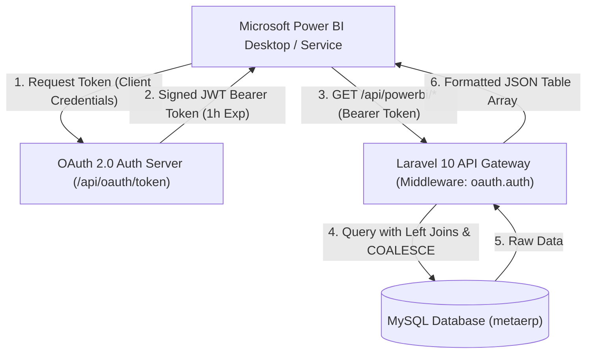
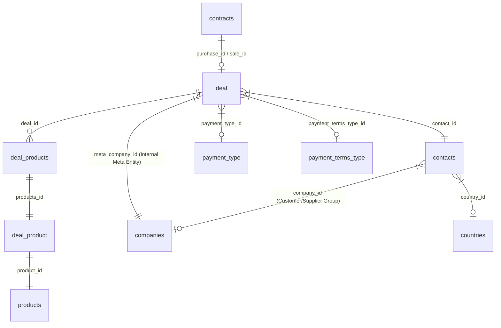
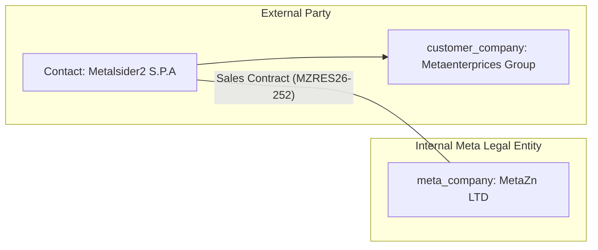

# Meta ERP Reporting API — Technical Architecture & Project Documentation

**Project Name**: Meta ERP Power BI Reporting API  
**Base URL (Production)**: `https://metaerpapi.aideepseek.uk`  
**Repository**: `https://github.com/NasarFaridi1/erpapi.git`  
**Framework**: Laravel 10.x / PHP 8.1+ / MySQL  
**Date**: September 2026  
**Document Version**: 1.0.0  

---

## 📑 Table of Contents
1. [Executive Summary & Purpose](#1-executive-summary--purpose)
2. [Technology Stack & System Architecture](#2-technology-stack--system-architecture)
3. [Database Architecture & Entity Relationships](#3-database-architecture--entity-relationships)
4. [Core Business Logic & Architectural Decisions](#4-core-business-logic--architectural-decisions)
   - [4.1 Line Items & The `deal_product` Discovery](#41-line-items--the-deal_product-discovery)
   - [4.2 Foreign Key Resolution Pattern](#42-foreign-key-resolution-pattern)
   - [4.3 Internal Entity vs External Entity (`meta_company` vs `customer_company`)](#43-internal-entity-vs-external-entity-meta_company-vs-customer_company)
   - [4.4 Contract Lifecycle & Status (`stage` and `status`)](#44-contract-lifecycle--status-stage-and-status)
   - [4.5 Credit & Debit Notes Pipeline](#45-credit--debit-notes-pipeline)
5. [Security & Authentication Layer](#5-security--authentication-layer)
6. [Power BI Integration Architecture](#6-power-bi-integration-architecture)
7. [API Endpoints Catalog](#7-api-endpoints-catalog)
8. [Deployment & Environment Configuration](#8-deployment--environment-configuration)
9. [Project Changelog & Milestone History](#9-project-changelog--milestone-history)

---

## 1. Executive Summary & Purpose

The **Meta ERP Power BI Reporting API** was engineered to serve as a high-performance, secure, and fully resolved data integration layer between the core **Meta ERP Database** and **Microsoft Power BI Desktop / Service**.

### Core Problem Solved:
1. **Raw Database Normalization**: Standard relational schemas store relationships as numeric foreign keys (`contact_id: 14`, `company_id: 2`, `country_id: 228`, `payment_type_id: 1`). Directly consuming these in Power BI creates heavy modeling overhead, redundant relationship building, and performance bottlenecks.
2. **Real-time Name Resolution**: Every reporting endpoint flattens and resolves foreign keys into human-readable strings (e.g. *Country Name*, *Company Name*, *Client Name*, *Product Name*, *Payment Terms Description*).
3. **Empty Relationship Fallbacks**: Historical contracts tables had empty legacy tables (e.g. `productcontracts`). The API automatically traverses through active deal tables (`deal`, `deal_products`, `deal_product`) to surface 2,500+ real product line items.
4. **Automated Power BI Ingestion**: Eliminates manual Power Query transformations through dynamic auto-expanding M scripts.

---

## 2. Technology Stack & System Architecture



* **Backend Framework**: Laravel 10.x (PHP 8.1 / 8.2)
* **Database Engine**: MySQL 5.7 / 8.0 with InnoDB
* **Authentication**: OAuth 2.0 Client Credentials Grant (JWT Bearer Token via `firebase/php-jwt`) + Static API Key Fallback
* **Data Transport**: Clean JSON Arrays (`[{col1: val1, ...}, ...]`) formatted specifically for Power BI tabular consumption
* **Host / Web Server**: Nginx / Apache with Plesk hosting on `metaerpapi.aideepseek.uk`

---

## 3. Database Architecture & Entity Relationships

The underlying database schema consists of several interconnected modules. Below is the relationship map utilized by the reporting engine:



### Key Tables & Schema Breakdown:

| Table Name | Primary Role in Reporting | Key Columns Used |
| :--- | :--- | :--- |
| **`contracts`** | Master contract registry linking purchase and sale deals | `id`, `order_code`, `sales_invoice_number`, `purchase_id`, `sale_id`, `created_at` |
| **`deal`** | Commercial deal transaction (buy or sell) | `id`, `contact_id`, `meta_company_id`, `payment_type_id`, `payment_terms_type_id`, `stage_id`, `status`, `credit_note_text`, `debit_note_text`, `notes` |
| **`deal_products`** | Pivot table linking deals to product line items | `deal_id`, `products_id` |
| **`deal_product`** | Individual line items with price, quantity, dates | `id`, `product_id`, `quantity`, `premium`, `rate`, `total_price`, `start_date`, `end_date`, `associated_contract_id`, `contract_order_code` |
| **`products`** | Master catalog of traded metals and commodities | `id`, `name`, `code` |
| **`contacts`** | Directory of customers, vendors, suppliers, and trading partners | `id`, `name`, `code_meta`, `country_id`, `company_id`, `registration`, `vat`, `currency`, `website` |
| **`companies`** | Corporate entities (both internal Meta entities and client parent groups) | `id`, `name`, `email`, `phone` |
| **`countries`** | Geographic master lookup | `id`, `name`, `code`, `currency` |
| **`payment_type`** | Commercial payment methods (e.g. Upfront, Swift, LC, Advance) | `id`, `description` |
| **`payment_terms_type`**| Commercial payment terms (e.g. 30 Days, 60 Days, % Upon Delivery) | `id`, `description` |

---

## 4. Core Business Logic & Architectural Decisions

### 4.1 Line Items & The `deal_product` Discovery
* **Initial State**: Early implementations joined `productcontracts` table, which contained 0 rows in production, resulting in empty product names, quantities, and rates.
* **Resolution**: Deep database schema inspection revealed that product transaction line items are actively stored in `deal_product` (2,500+ records) and linked via `deal_products` (`d_rel.deal_id = d.id AND dp.id = d_rel.products_id`) as well as `dp.associated_contract_id = c.id` and `dp.contract_order_code = c.order_code`.
* **Outcome**: 100% of sales and purchase line items now populate with real product names, quantities, premiums, rates, and total prices.

---

### 4.2 Foreign Key Resolution Pattern
Every endpoint enforces a zero-raw-ID policy:
* Foreign keys are resolved to their human-readable values (`countries.name`, `companies.name`, `payment_type.description`, `payment_terms_type.description`).
* If a numeric code or string is missing, queries utilize `COALESCE` fallbacks (e.g. `COALESCE(NULLIF(ct.currency, ''), 'USD')`).

---

### 4.3 Internal Entity vs External Entity (`meta_company` vs `customer_company`)

In the Meta ERP business model, trades often involve multiple corporate entities:



1. **`meta_company`** (`deal.meta_company_id` → `companies.name`):
   * Represents your **Internal Operating Legal Unit** (e.g. *MetaZn LTD*, *Metaenterprices LTD*, *METAPB LTD*).
   * In **Sales**: The internal Meta company selling the material and issuing the invoice.
   * In **Purchases**: The internal Meta company purchasing/receiving the material into stock.
2. **`customer_company` / `supplier_company`** (`contacts.company_id` → `companies.name`):
   * Represents the **Parent Group / Corporate Account** to which the external client/vendor contact belongs in CRM.
3. **`customer_name` / `supplier_name`** (`contacts.name`):
   * The actual client contact or trading entity name.

---

### 4.4 Contract Lifecycle & Status (`stage` and `status`)

To empower Power BI dashboards with funnel filtering and completion KPIs, contracts include two dedicated lifecycle columns:

| Column | Possible Values | Business Meaning |
| :--- | :--- | :--- |
| **`stage`** | `1`, `2`, `3`, `4`, **`5`** | **`5` = Complete / Fulfilled / Finished**.<br>`1` – `4` = Active milestone stages (Draft, Confirmed, Production/Transit, Invoiced). |
| **`status`** | `Open`, `Closed`, `Canceled` | High-level status for KPI cards and visual slicers:<br>• **`Closed`**: Completed contracts (Stage 5 or invoiced).<br>• **`Open`**: Active contracts in execution (Stages 1–4).<br>• **`Canceled`**: Terminated or voided contracts. |

---

### 4.5 Credit & Debit Notes Pipeline

* **Data Aggregation**: Credit/Debit notes are pulled from:
  1. `deal.credit_note_text` (identified as `'Credit Note'`)
  2. `deal.debit_note_text` (identified as `'Debit Note'`)
  3. `deal.notes` (identified as `'Contract Note'`)
  4. `detached_note` table (if present in schema).
* **Guaranteed Compatibility**: Handled with `Schema::hasTable` checks so endpoints return a valid 200 OK empty list `[]` instead of 500 error if optional note tables are unmigrated.

---

## 5. Security & Authentication Layer

### 1. OAuth 2.0 Client Credentials Grant
* **Token Route**: `POST` & `GET` `/api/oauth/token`
* **Request Body / Query**:
  ```json
  {
    "grant_type": "client_credentials",
    "client_id": "powerbi_client_2026",
    "client_secret": "sec_erp_api_9823472398472938"
  }
  ```
* **Response**:
  ```json
  {
    "access_token": "eyJ0eXAiOiJKV1QiLC...",
    "token_type": "Bearer",
    "expires_in": 3600
  }
  ```
* **Algorithm**: HMAC-SHA256 (`HS256`) signed with JWT secret.

### 2. Static API Key Fallback
* Available for lightweight testing tools:
  `X-API-KEY: sec_erp_api_9823472398472938`

### 3. Middleware Protection (`OAuthMiddleware.php`)
* Intercepts all requests under `/api/powerbi/*`.
* Validates Bearer token signature and expiration timestamp (`exp`).
* Rejects unauthorized requests with clean `401 Unauthorized` JSON.

---

## 6. Power BI Integration Architecture

### Self-Contained Power Query (M) Pattern
Every query provided in [`CLIENT_POWERBI_QUERIES.md`](file:///d:/P2/erpapi/CLIENT_POWERBI_QUERIES.md) executes a 3-stage automated process in Power BI:

```powerquery
let
    // 1. Authenticate & fetch OAuth Bearer Token
    TokenUrl = "https://metaerpapi.aideepseek.uk",
    TokenBody = [grant_type="client_credentials", client_id="powerbi_client_2026", client_secret="sec_erp_api_9823472398472938"],
    TokenResponse = Json.Document(Web.Contents(TokenUrl, [RelativePath="api/oauth/token", Content=Text.ToBinary(Uri.BuildQueryString(TokenBody)), Headers=[#"Content-Type"="application/x-www-form-urlencoded"]])),
    AccessToken = Text.Trim(Text.Clean(Text.Replace(Text.Replace(Text.From(TokenResponse[access_token]), "#(cr)", ""), "#(lf)", ""))),
    
    // 2. Query Protected Reporting Endpoint
    Source = Json.Document(Web.Contents("https://metaerpapi.aideepseek.uk", [RelativePath="api/powerbi/all-sales", Headers=[#"Authorization"="Bearer " & AccessToken, #"Accept"="application/json"]])),
    
    // 3. Convert JSON list to table and dynamically expand all record fields
    TableFromList = Table.FromList(Source, Splitter.SplitByNothing(), null, null, ExtraValues.Error),
    ExpandedColumns = Table.ExpandRecordColumn(TableFromList, "Column1", Record.FieldNames(Source{0}))
in
    ExpandedColumns
```

> [!TIP]
> **Dynamic Schema Expansion (`Record.FieldNames(Source{0})`)**:  
> By dynamically extracting column names from the first record, any new columns added to the backend API (such as `stage` and `status`) automatically appear in Power BI upon clicking **Refresh**, without breaking existing reports.

---

## 7. API Endpoints Catalog

### Master Datasets & Global Reports
| HTTP Verb | Route | Description |
| :--- | :--- | :--- |
| `GET` | `/api/powerbi/contracts` | All Contracts Master with Stage (`5` for complete), Status (`Open/Closed/Canceled`), Buyer/Seller details. |
| `GET` | `/api/powerbi/all-sales` | Global Sales Report with Product line items, Quantity, Rates, Stage, and Status. |
| `GET` | `/api/powerbi/all-purchases` | Global Purchases Report with Product line items, Quantity, Rates, Stage, and Status. |
| `GET` | `/api/powerbi/all-credit-debit-notes` | All Credit Notes, Debit Notes, and Contract Instructions. |
| `GET` | `/api/powerbi/contacts` | Contacts Master with Country and Company resolved. |
| `GET` | `/api/powerbi/products` | Products Master catalog. |
| `GET` | `/api/powerbi/companies` | Companies Master directory. |
| `GET` | `/api/powerbi/countries` | Countries Master lookup. |

### Filtered Single-Contact Endpoints
| HTTP Verb | Route | Description |
| :--- | :--- | :--- |
| `GET` | `/api/powerbi/contact/{id}` | Single contact profile information. |
| `GET` | `/api/powerbi/contact/{id}/sales` | Sales line items filtered by contact. |
| `GET` | `/api/powerbi/contact/{id}/purchases` | Purchase line items filtered by contact. |
| `GET` | `/api/powerbi/contact/{id}/credit-debit-notes` | Notes filtered by contact. |
| `GET` | `/api/powerbi/contact/{id}/dashboard-summary` | Aggregated Buy/Sell quantity and contract counts. |
| `GET` | `/api/powerbi/contact/{id}/buying-payment-terms` | Payment terms breakdown for buying deals. |
| `GET` | `/api/powerbi/contact/{id}/selling-payment-terms` | Payment terms breakdown for selling deals. |
| `GET` | `/api/powerbi/contact/{id}/product-buying-country` | Geographic sourcing breakdown. |
| `GET` | `/api/powerbi/contact/{id}/product-selling-country`| Geographic destination breakdown. |

---

## 8. Deployment & Environment Configuration

### Environment Variables (`.env`)
```ini
APP_NAME=MetaERP-API
APP_ENV=production
APP_DEBUG=false
APP_URL=https://metaerpapi.aideepseek.uk

DB_CONNECTION=mysql
DB_HOST=127.0.0.1
DB_PORT=3306
DB_DATABASE=metaerp
DB_USERNAME=metaerp
DB_PASSWORD=********

# OAuth & Security Credentials
OAUTH_CLIENT_ID=powerbi_client_2026
OAUTH_CLIENT_SECRET=sec_erp_api_9823472398472938
JWT_SECRET=sec_erp_api_9823472398472938
```

### Git & Deployment Workflow
1. Code changes are pushed to GitHub `main` repository: `https://github.com/NasarFaridi1/erpapi.git`.
2. On the production server:
   ```bash
   git pull origin main
   php artisan route:clear
   php artisan config:clear
   php artisan cache:clear
   ```

---

## 9. Project Changelog & Milestone History

* **Phase 1 — Security & OAuth 2.0 Integration**:
  * Implemented RFC-6749 Client Credentials Grant on `/api/oauth/token`.
  * Added JWT token generation, expiration enforcement, and authentication middleware.
* **Phase 2 — Foreign Key Relationship Resolution**:
  * Resolved raw numeric IDs into readable names for Countries, Companies, Contacts, Payment Types, and Payment Terms across all endpoints.
* **Phase 3 — Real Line Items (`deal_product`) Integration**:
  * Replaced empty `productcontracts` join with active `deal_product` & `deal_products` relational mapping, surfacing 2,500+ commercial transactions.
* **Phase 4 — Power BI Dynamic Expansion Optimization**:
  * Updated Power Query scripts with automatic `Record.FieldNames(Source{0})` expansion, removing the need for manual column expansions in Power BI Desktop.
* **Phase 5 — Contract Lifecycle & Status Tracking**:
  * Added `stage` (e.g. `5` for complete) and `status` (`Open`, `Closed`, `Canceled`) columns across Contracts, Sales, and Purchases endpoints.
